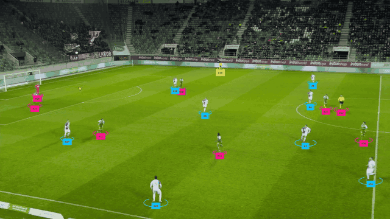
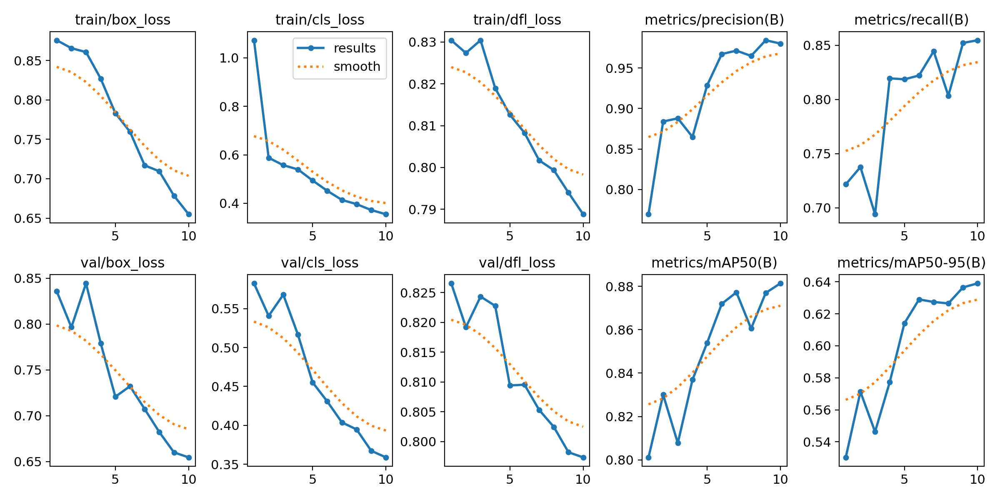
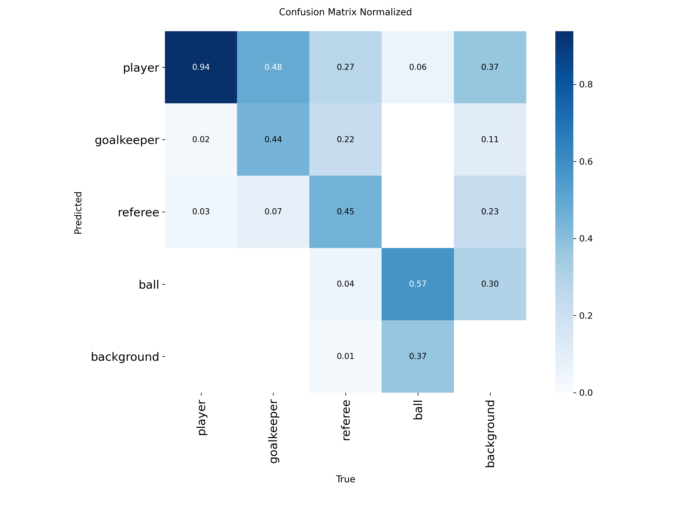

# football-cv-tracking

Detection + tracking cầu thủ / thủ môn / trọng tài / bóng trên video bóng đá broadcast, đánh giá trên SoccerNet-Tracking.



*SoccerNet SNMOT-060, toàn bộ pipeline: BoT-SORT đã tinh chỉnh, phân đội SigLIP + UMAP (xanh dương / hồng), trọng tài (vàng), bóng (tam giác vàng). Video 30 s đầy đủ: <!-- TODO: link YouTube / Drive -->*

## Pipeline

```
frame ─► YOLO (imgsz 1280) ─┬─ người (conf ≥ 0.25) ─► BoT-SORT (new_track_thresh 0.8) ─► phân đội (SigLIP → UMAP → KMeans k=3, vote trượt theo track ID)
                            └─ bóng  (conf ≥ 0.1)  ─► [SAHI tile 960 → 640] ─► BallTracker (1 bóng/frame, lọc nhảy) ─┴─► vẽ + xuất MOT
```

## Cấu trúc

```
configs/        data.yaml, bytetrack.yaml, botsort.yaml, botsort_reid.yaml, botsort_tuned.yaml (mặc định), ablation/
src/
  detection/    detector.py (YOLO -> sv.Detections, map class), ball_sahi.py (sliced inference cho bóng)
  tracking/     trackers.py (bọc tracker Ultralytics), ball_tracker.py
  team/         team_classifier.py (SigLIP + UMAP + KMeans, TeamAssigner)
  pitch/        config.py (sân FIFA 105×68 m, 32 keypoint, flip_idx), keypoints.py (YOLO-pose),
                homography.py (RANSAC + kiểm tra H + làm mượt One-Euro + phát hiện cắt cảnh), radar.py
  eval/         export_mot.py, run_trackeval.py (HOTA / IDF1 / IDSW)
  viz/          annotate.py
  utils/        label_mapping.py
scripts/        prepare_dataset.py, train.py, infer_video.py,
                eval_soccernet.py, analyze_idsw.py, eval_ball.py, eval_team.py,
                prepare_pitch_dataset.py, train_pitch.py
notebooks/      kaggle_train.ipynb, kaggle_eval.ipynb, kaggle_train_pitch.ipynb
```

## Cài đặt

```bash
pip install -r requirements.txt
```

## Sử dụng

Train trên Kaggle: `notebooks/kaggle_train.ipynb`. Code / debug ở local, chạy được với GPU 4GB.

```bash
# Chạy thử pipeline bằng model COCO trước khi có model 4 class (person -> player, sports ball -> ball)
python scripts/infer_video.py --source data/clip.mp4 --weights yolo11n.pt --max-frames 100

# Đầy đủ
python scripts/infer_video.py --source data/clip.mp4 --weights outputs/best.pt \
    --sahi --team --mot-out outputs/mot/clip.txt

# Đánh giá trên subset SoccerNet-Tracking
python scripts/eval_soccernet.py --data-root data/SoccerNet/tracking/test --weights outputs/best.pt \
    --trackers configs/bytetrack.yaml configs/botsort_tuned.yaml --limit 10
```

## Kết quả

### Detection (val)

38 ảnh val, `imgsz 1280`.

| Class | Instances | P | R | AP50 | AP50-95 |
|---|---|---|---|---|---|
| **all** | 905 | 0.981 | 0.855 | **0.882** | **0.654** |
| player | 754 | 0.990 | 0.984 | 0.994 | 0.844 |
| goalkeeper | 27 | 0.984 | 0.926 | 0.987 | 0.777 |
| referee | 89 | 0.960 | 0.966 | 0.976 | 0.726 |
| ball | 35 | 0.988 | 0.543 | 0.569 | 0.269 |

Người được detect gần như hoàn hảo. Điểm yếu là bóng: precision 0.988 nhưng recall chỉ 0.543. Nghĩa là box bóng nào model đưa ra thì hầu như đúng, nhưng gần một nửa số bóng bị bỏ sót, vì bóng chỉ chiếm vài pixel ở khung hình broadcast. Đây là lý do dùng SAHI cho bóng (xem bảng bên dưới).

Đường cong train (loss / mAP theo epoch) và confusion matrix chuẩn hóa trên val:





### Bóng: full-frame vs SAHI

Đo bằng `scripts/eval_ball.py` trên SoccerNet-Tracking SNMOT-061 → 065, mỗi 5 frame lấy 1 (750 frame). Detector train trên Roboflow nên không bị lộ dữ liệu. Bóng GT có kích thước trung vị 14×12 px nên một detection được tính là đúng khi tâm cách tâm GT ≤ 15 px. FPS đo phần detection trên GTX 1050 Ti.

| Cấu hình | Recall | Precision | F1 | FPS |
|---|---|---|---|---|
| Full-frame, conf bóng 0.25 | 0.485 | 0.897 | 0.630 | 5.7 |
| SAHI tile 640 → imgsz 640 | 0.420 | 0.754 | 0.539 | 1.5 |
| SAHI tile 960 → imgsz 640 | 0.549 | 0.821 | 0.658 | 1.5 |
| Full-frame, conf bóng 0.1 | 0.559 | 0.789 | 0.654 | 4.4 |
| **Full-frame, conf bóng 0.1 + BallTracker** | 0.552 | **0.894** | **0.682** | **4.4** |
| SAHI 960 + BallTracker | 0.546 | 0.887 | 0.676 | 1.5 |
| Full + SAHI 960 + BallTracker | 0.550 | 0.866 | 0.673 | 1.5 |

Kết luận:
- **Scale của tile quyết định SAHI có giúp hay không.** Model train ở 1920→1280 (×0.67). Tile 640 → 640 làm bóng to gấp 1.5 lần so với lúc train, và recall giảm thay vì tăng. Tile 960 → 640 giữ đúng ×0.67 thì recall tăng 0.42 → 0.549.
- **Hạ conf + lọc bằng tracker hiệu quả ngang SAHI mà nhanh gấp khoảng 3 lần.** Hạ ngưỡng bóng xuống 0.1 kéo recall lên mức của SAHI. BallTracker (giữ 1 bóng/frame, loại điểm nhảy xa) đưa precision từ 0.789 lên 0.894. Đây là cấu hình mặc định; SAHI để tùy chọn `--sahi`.
- **Recall chững lại ở khoảng 0.55 với mọi cấu hình**, nên giới hạn không nằm ở độ phân giải. Giả thuyết: các frame bị bỏ sót là frame khó (bóng bị che, bị nhòe khi bay nhanh, nằm sát vạch trắng) và tập train có quá ít bóng (val chỉ có 35 instance). Nếu đúng, thêm dữ liệu bóng để train sẽ có tác dụng hơn đổi cách inference. Cần xem lại các frame bị bỏ sót để xác nhận.

### Tracking

Đo bằng `scripts/eval_soccernet.py` (TrackEval, chỉ tính người, không tính bóng). Mọi tracker nhận **cùng một bộ detection** (đã cache) nên khác biệt chỉ đến từ tracker. Tham số được chọn trên SNMOT-061 → 065 (tập tinh chỉnh), còn bảng dưới đo trên **SNMOT-066 → 070, tập không dùng khi tinh chỉnh**. FPS là FPS của riêng tracker (không tính detect) trên GTX 1050 Ti.

| Tracker | HOTA | IDF1 | IDSW | MOTA | FPS tracker |
|---|---|---|---|---|---|
| ByteTrack (mặc định Ultralytics) | 43.1 | 46.1 | 1113 | 71.1 | 356 |
| BoT-SORT (GMC) | 46.4 | 52.3 | 921 | 70.9 | 29 |
| BoT-SORT + ReID `yolo26n-cls` | 47.6 | 53.7 | 1251 | 67.7 | 8 |
| ByteTrack, `new_track_thresh` 0.8 | 51.1 | 59.3 | 318 | 78.9 | **547** |
| **BoT-SORT, `new_track_thresh` 0.8** (`configs/botsort_tuned.yaml`, mặc định) | **53.6** | 64.5 | 257 | **79.1** | 31 |
| BoT-SORT, `new_track_thresh` 0.85 | 52.8 | **64.8** | 229 | 76.8 | 31 |
| BoT-SORT, `new_track_thresh` 0.9 | 48.5 | 63.2 | **172** | 67.1 | 31 |
| BoT-SORT + ReID, `new_track_thresh` 0.8 | 51.9 | 61.8 | 459 | 77.3 | 8 |

Kết quả trên tập tinh chỉnh cùng xu hướng (BoT-SORT mặc định 47.2 → 52.6 HOTA với ngưỡng 0.8), nên cấu hình được chọn không bị overfit.

**Thay đổi quan trọng nhất là một tham số:** `new_track_thresh` 0.25 → 0.8 giảm ID switch 72% (921 → 257) và tăng HOTA 7.2 điểm. GMC đóng góp thêm khoảng 2.5 HOTA, còn ReID làm kết quả xấu đi.

#### Vì sao: phân loại ID switch (`scripts/analyze_idsw.py`)

Mỗi frame ghép GT ↔ track (Hungarian, IoU ≥ 0.5, ưu tiên giữ cặp cũ như TrackEval) rồi phân loại mỗi lần một người đổi ID. Tổng số đếm được khớp với TrackEval (899 so với 921).

| Nguyên nhân | BoT-SORT mặc định | BoT-SORT 0.8 |
|---|---|---|
| Track cũ đứt, track mới thay ngay (frame trước còn đúng) | **443** | **19** |
| Track mới sau khi mất dấu | 209 | 109 |
| Tráo ID với người khác | 132 | 90 |
| 2 track cùng bám 1 người | 115 | 34 |
| *Trong đó: xảy ra khi đang chồng lấn người khác* | *401* | *150* |

- **Nguyên nhân chính là track thừa từ detection conf thấp.** Khi một detection không ghép được với track (do dự đoán Kalman lệch), ngưỡng 0.25 cho phép nó sinh ngay một ID mới, và ID mới này thường thắng track cũ ở frame sau. Detector có precision 0.99 với người nên đòi conf ≥ 0.8 mới tạo track chỉ loại nhiễu mà hầu như không bỏ sót người thật. Tới 0.9 thì bắt đầu bỏ sót cầu thủ mới vào khung hình (MOTA giảm 12 điểm).
- **Giả thuyết bị loại:** tắt `fuse_score` làm HOTA giảm 47.2 → 44.0; hạ conf người xuống 0.1 để dùng tầng ghép thứ 2 của ByteTrack thì HOTA không tăng mà tracker chậm hơn.
- **Lỗi còn lại cần ReID thật:** sau khi chỉnh ngưỡng, lỗi chủ yếu là mất dấu lâu rồi ra ID mới (trung vị 67 frame ≈ 2.7 s, dài hơn `track_buffer` 50 frame: cầu thủ ra khỏi khung hình rồi quay lại) và tráo ID khi chồng lấn. IoU + Kalman không giải quyết được hai loại này.

**Hạn chế:** ReID trong bảng dùng `yolo26n-cls.pt`, một model phân loại ImageNet, không phải model ReID được train cho người. Embedding của nó không phân biệt được cầu thủ cùng đội mặc áo giống nhau, nên ReID tăng tráo ID thay vì giảm. Kết luận "ReID không giúp" chỉ đúng với model này. Cần thử lại với model ReID thật (vd OSNet qua BoxMOT).

### Phân đội

Đo bằng `scripts/eval_team.py` trên SNMOT-061 → 070 (10 sequence, mỗi 5 frame). Nhãn đội thật lấy từ `gameinfo.ini` của SoccerNet (`player team left/right`). Các cụm KMeans không có tên nên mỗi sequence lấy cách ghép cụm ↔ đội tốt nhất. Track lấy từ `botsort_tuned`, crop để fit KMeans lấy mỗi 25 frame. Accuracy tính trên cầu thủ (không tính thủ môn, trọng tài).

| Embedding → giảm chiều, số cụm | Từng crop | Vote 10 đầu | Vote trượt 5 | Vote trượt 15 | Seq tệ nhất |
|---|---|---|---|---|---|
| Màu áo (Lab, bỏ pixel cỏ), k=2 | 0.620 | 0.617 | 0.626 | 0.630 | 0.508 |
| SigLIP → PCA, k=2 | 0.561 | 0.599 | 0.569 | 0.574 | 0.515 |
| SigLIP → PCA, k=3 | 0.653 | 0.655 | 0.655 | 0.654 | 0.509 |
| SigLIP → UMAP, k=2 | 0.923 | 0.864 | 0.927 | 0.922 | 0.503 |
| **SigLIP → UMAP, k=3** (mặc định) | **0.939** | 0.890 | **0.944** | **0.940** | **0.754** |

- **UMAP là yếu tố quyết định, không phải SigLIP.** Cùng embedding SigLIP, giảm chiều bằng PCA cho kết quả gần như đoán bừa (0.56). UMAP giữ cấu trúc cụm cục bộ nên tách được 2 đội (0.92). Màu áo trung bình cũng không đủ (0.62), vì ánh sáng, bóng đổ và số áo làm màu bị lệch.
- **KMeans 3 cụm sửa được trường hợp thất bại hoàn toàn.** Ở SNMOT-063, KMeans(2) chia thành "cầu thủ" và "trọng tài áo vàng" thay vì chia 2 đội (accuracy 0.503). Nguyên nhân là trọng tài và thủ môn bị detector gán nhầm thành player, mà màu áo của họ khác biệt nhất. Với 3 cụm, cụm thứ 3 hút nhóm này, còn 2 cụm lớn nhất là 2 đội; sequence tệ nhất tăng từ 0.503 lên 0.754.
- **Bỏ phiếu phải theo cửa sổ trượt.** Chỉ lấy 10 dự đoán đầu rồi chốt nhãn làm accuracy *giảm* so với từng crop (0.939 → 0.890), vì khi tracker tráo ID giữa 2 cầu thủ khác đội, nhãn cũ bị giữ đến hết track. Lấy đa số trong 5–15 dự đoán gần nhất thì vote tốt hơn từng crop. Mặc định chọn 15: chênh với 5 không đáng kể (0.940 so với 0.944) mà nhãn ít nhấp nháy hơn.
- **Thủ môn chưa đánh giá được.** Trên SoccerNet, detector gần như không bao giờ gán class goalkeeper (vd SNMOT-063: 2 detection goalkeeper so với 12253 player), dù trên val Roboflow goalkeeper đạt AP50 0.987. Thủ môn bị coi là player và bị phân đội theo màu áo, mà áo thủ môn khác đồng đội nên thường bị xếp sai đội hoặc rơi vào cụm thứ 3.

### Radar: hình học sân

Đo bằng `scripts/eval_pitch.py` trên SoccerNet **GSR test** (SNGS-116 → 118, 2250 frame). GSR có vị trí chân thật của từng người trên sân (mét). Để đo riêng homography, không lẫn lỗi detector, lấy điểm chân GT trên ảnh chiếu qua H của mình rồi so với vị trí thật. Sân chuẩn FIFA 105×68 m (`src/pitch/config.py`).

| Model keypoint | Homography | Phủ frame | Sai số TB | Trung vị | ≤ 1 m | ≤ 2 m | Rung trung vị (cm/frame²) |
|---|---|---|---|---|---|---|---|
| Roboflow (có sẵn) | H thô | 60% | 8.25 m | 5.87 m | 6% | 14% | 92.1 |
| **Tự train (+ nhãn GSR)** | H thô | 32% | **1.63 m** | **1.27 m** | 39% | 72% | 23.1 |
| **Tự train (+ nhãn GSR)** | One-Euro (mặc định) | **46%** | 2.22 m | 1.57 m | 30% | 63% | **10.1** |

GT có độ rung 0.5 cm/frame² (người thật chạy mượt).

- **Model keypoint có sẵn sai vài mét trên SoccerNet.** Đo từng keypoint bằng H tính từ GT: góc sân xa lệch khoảng 11 m dù conf cao, vòng cấm lệch 1–4 m. Không bước hậu xử lý nào sửa được keypoint sai (đã thử RANSAC theo pixel/mét, bỏ điểm góc, lật nhãn trái/phải).
- **Sinh nhãn cùng domain từ GSR** (`scripts/make_pitch_labels_gsr.py`): fit H bằng DLT gộp chân người (ảnh ↔ sân) với các điểm nằm trên vạch sân đã vẽ tay (vd biên dọc Y = 0). Kiểm định chéo: H gộp khớp trung vị 0.14 m, còn chỉ dùng vạch sân thì p90 lên 31 m. Train `yolo11m-pose` trên Roboflow + khoảng 1000 ảnh GSR train (không trùng clip test): sai số trung vị **5.87 m → 1.27 m**.
- **Loại H vô lý:** vùng cỏ của ảnh phải chiếu vào trong sân (cho phép lệch 30 m). Bước này loại các frame có 4–5 keypoint mà một điểm sai, vốn đẩy sai số trung bình lên 35 m. Ngưỡng 15 m loại oan cảnh quay sát khung thành (góc ảnh rơi vào khán đài).
- **Làm mượt:** chiếu một lưới điểm cố định trên ảnh ra sân, lọc toạ độ (m) bằng One-Euro, fit lại H; giữ H cũ tối đa 1 s khi không có H tốt, reset khi phát hiện cắt cảnh. Rung giảm khoảng 2.3 lần (23.1 → 10.1) và phủ tăng 32% → 46%, đổi lại sai số tăng nhẹ do frame giữ H cũ và độ trễ khi camera lia. Bản đầu neo lưới trên sân: điểm sân ngoài khung hình chiếu vào ảnh rất bất ổn, làm rung tăng thay vì giảm.
- **Giới hạn: chỉ khoảng một nửa số frame có H.** 46% frame có dưới 4 keypoint tin cậy (camera quay giữa sân chỉ thấy vạch giữa + vòng tròn), 20% có keypoint sai. Bộ 32 điểm thưa ở giữa sân; cần thêm điểm (vd trên vòng tròn giữa sân) hoặc train thêm.

## Phân tích lỗi & hạn chế

Tổng hợp từ các phần đo ở trên, xếp theo mức ảnh hưởng:

1. **Detector nhầm vai trò trên SoccerNet.** Trên val Roboflow, goalkeeper và referee có AP50 trên 0.97, nhưng trên SoccerNet detector gần như không bao giờ ra class goalkeeper, và đôi khi đổi chỗ referee ↔ player (thấy được trong demo: trọng tài giữa sân bị tô màu đội). Đây là khoảng cách domain giữa 2 bộ dữ liệu (val Roboflow chỉ có 27 thủ môn). Lỗi này lan sang phân đội: thủ môn và trọng tài bị nhầm thành player sẽ bị gán vào một đội. Hướng sửa: fine-tune thêm trên ảnh SoccerNet, vì `gameinfo.ini` có sẵn vai trò của từng tracklet.
2. **ID switch còn lại cần ReID thật.** Sau khi chỉnh `new_track_thresh`, lỗi chính là cầu thủ ra khỏi khung hình khoảng 2–3 s rồi quay lại với ID mới, và tráo ID khi 2 người chồng lấn. ReID đang dùng (`yolo26n-cls`) là model phân loại ImageNet nên làm tệ hơn. Cần thử OSNet (BoxMOT).
3. **Recall bóng chững lại ở khoảng 0.55.** Đổi cách inference (SAHI, hạ conf) không vượt được mức này. Giả thuyết là các frame bị bỏ sót là bóng bị che hoặc nhòe khi bay nhanh, cộng với tập train có ít bóng; chưa xác nhận bằng cách xem từng frame.
4. **Phân đội thất bại khi trọng tài / thủ môn chiếm một cụm lớn.** KMeans 3 cụm sửa được phần lớn, nhưng sequence tệ nhất vẫn ở 0.754. Phân đội cũng chỉ được fit trong từng video và cần khoảng 25 s đầu để fit UMAP.
5. **Tốc độ.** Trên GTX 1050 Ti, toàn bộ pipeline có phân đội chạy khoảng 1.1 FPS (SigLIP phân loại mọi cầu thủ mỗi frame). Không phân đội thì bị giới hạn bởi detect (4.4 FPS); riêng BoT-SORT chạy 31 FPS. Đánh giá trên tập train của SoccerNet (SNMOT-061 → 070) vì máy local chưa giải nén tập test; detector không train trên SoccerNet nên không lộ dữ liệu.
