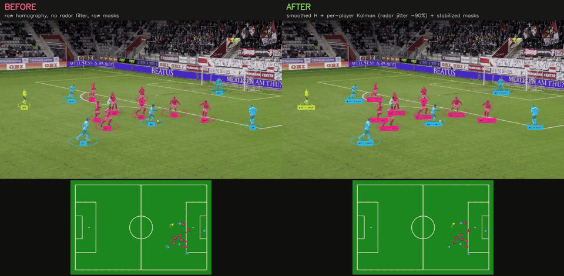
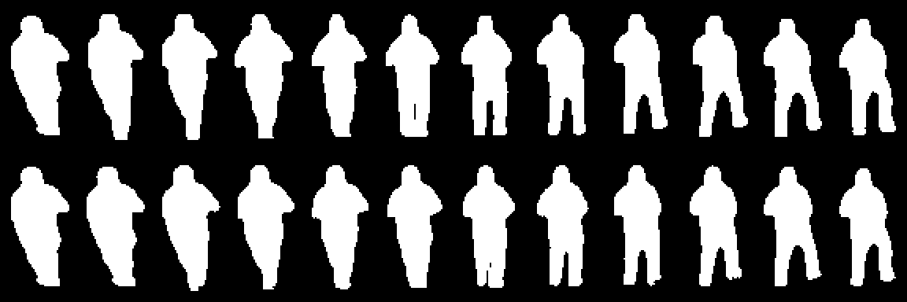

# Đo trước khi sửa: chống rung overlay trong video bóng đá

*Ellipse dưới chân cầu thủ, chấm trên radar, bóng người tô màu: những lớp vẽ này rung là thứ người xem nhận ra đầu tiên. Bài này kể cách mình đo độ rung, tìm ra nó thật sự nằm ở đâu, và giảm 90% rung trên radar mà sai số vị trí chỉ tăng 3 cm.*



*Trái: homography thô, không lọc, mask từng frame. Phải: homography làm mượt, Kalman theo từng cầu thủ, mask ổn định. Video 30 s: [YouTube](https://youtu.be/YHe2ba2jRTI).*

Code: [football-cv-tracking](https://github.com/thaisanh1602/football_cv_tracking), dữ liệu đánh giá: SoccerNet Tracking và SoccerNet Game State Reconstruction (GSR).

## 1. Vấn đề: "trông rung" không phải là một con số

Pipeline của mình gồm: YOLO detect cầu thủ, BoT-SORT gán ID, phân đội, rồi chiếu vị trí chân lên sân 105×68 m qua homography để vẽ radar. Xem video thì thấy overlay rung, nhưng câu "trông rung" không giúp chọn cách sửa, cũng không cho biết sửa xong đã tốt hơn bao nhiêu.

Nên việc đầu tiên là định nghĩa một metric.

## 2. Metric: gia tốc, sau khi trừ chuyển động camera

Một chuyển động mượt có gia tốc nhỏ. Rung là vị trí giật qua lại giữa các frame, tức gia tốc rời rạc lớn:

```
a_t = p_t − 2·p_{t−1} + p_{t−2}
```

Có hai cái bẫy khi áp vào video bóng đá:

1. **Camera broadcast lia và zoom liên tục.** Vị trí pixel của cầu thủ đổi cả khi họ đứng yên. Mình ước lượng chuyển động camera giữa 2 frame (optical flow thưa trên nền sân, bỏ vùng có người, fit affine bằng RANSAC), rồi đưa 2 điểm cũ về toạ độ frame hiện tại trước khi tính gia tốc. Module này khớp với GMC của Ultralytics trong vòng 0.5 px.
2. **Người ở xa nhỏ hơn người ở gần.** Rung 2 px trên một người cao 40 px khác hẳn trên người cao 200 px, nên chia cho chiều cao box.

Trên radar thì đơn giản hơn: vị trí đã ở mét trên mặt sân, gia tốc tính bằng cm/frame².

**Rung thấp chưa đủ.** Lọc thật mạnh thì overlay đứng im, nhưng trễ xa so với cầu thủ. Vì vậy mọi kết quả trong bài đều báo cáo **hai trục**: độ rung và sai số so với ground truth (GT). Bộ lọc chạy nhân quả (chỉ dùng frame hiện tại và trước đó, như khi chạy live), nên sai số đã gồm độ trễ.

## 3. Phát hiện 1: ellipse đã mượt rồi

Đo trên 10 sequence SoccerNet Tracking (đơn vị: % chiều cao box):

| Điểm neo ellipse | Rung trung vị | Rung p90 | Sai số so với GT |
|---|---|---|---|
| Detection thô | 2.53 | 8.51 | 4.26 |
| Kalman bên trong BoT-SORT | **1.49** | **4.91** | 4.20 |
| GT (chú thích tay) | 1.62 | 7.26 | — |

Kalman bên trong tracker đã đưa ellipse xuống **ngang mức GT**. GT cũng "rung", vì toạ độ là số nguyên và được vẽ tay: lệch 1 px trên người cao 80 px đã là hơn 1%.

Nếu không đo, mình đã bỏ cả tuần để tối ưu một thứ đã tốt sẵn.

Một chi tiết suýt làm mình kết luận sai: sau khi bù camera, *vận tốc* của cầu thủ lại **tăng** chứ không giảm. Mình tưởng module bù camera hỏng. Hoá ra camera broadcast lia *theo* cầu thủ, nên trên ảnh họ di chuyển ít hơn nền sân; bù camera xong mới thấy vận tốc thật so với mặt sân. Module đúng, giả định của mình sai.

## 4. Phát hiện 2: rung thật nằm ở radar

Trên SoccerNet GSR (có vị trí thật của từng người trên sân), chấm radar rung **23 cm/frame²**, trong khi người thật chỉ **0.5**: gấp 46 lần.

Lý do nằm ở hình học. Homography biến pixel thành mét, và ở vùng xa camera 1 pixel tương ứng vài chục cm trên sân. Keypoint sân lệch 1–2 px giữa 2 frame là toàn bộ radar giật theo.

## 5. Sửa ở hai tầng

**Tầng 1: làm mượt homography.** Lọc thẳng 9 hệ số của ma trận H là vô nghĩa (khác đơn vị, khác độ lớn). Cách mình dùng: lấy một lưới điểm cố định, chiếu qua H, lọc toạ độ của lưới bằng One-Euro, rồi fit lại H.

Bản đầu tiên đặt lưới **trên sân** và làm rung **tăng** 2–4 lần. Điểm sân nằm ngoài khung hình (gần đường chân trời) khi chiếu vào ảnh có toạ độ tiến ra vô cùng, và bộ lọc làm mượt chính những điểm vô nghĩa đó. Đặt lưới **trên ảnh** (vùng cỏ ở 2/3 dưới khung hình) thì rung giảm từ 23.1 xuống 10.1.

**Tầng 2: Kalman theo từng cầu thủ, sau homography.** Mỗi track có một Kalman vận tốc không đổi, trạng thái (x, y, vx, vy) trên sân:

| Homography + lọc vị trí | Sai số trung vị | Rung (cm/frame²) |
|---|---|---|
| H làm mượt, không lọc | 1.57 m | 10.1 |
| + EMA α = 0.1 | 1.72 m | 1.0 |
| + One-Euro | 1.62 m | 1.8 |
| **+ Kalman σa = 2 m/s²** | **1.60 m** | **1.0** |

Ở cùng mức rung, EMA trễ hơn Kalman 12 cm. EMA chỉ "kéo" vị trí về quá khứ; Kalman có mô hình vận tốc nên dự đoán được cầu thủ sắp ở đâu và bám kịp khi họ chạy.

Kết quả: **rung giảm 90% (10.1 → 1.0 cm/frame², còn khoảng 2 lần người thật), sai số chỉ tăng 3 cm.**

Bộ lọc tự reset khi một track nhảy xa hơn mức con người chạy được (12 m/s cộng biên nhiễu). Đó là dấu hiệu ID switch hoặc H hỏng; không reset thì chấm radar sẽ trượt từ từ qua nửa sân.

## 6. Mask: nhấp nháy theo hình dạng

YOLO-seg cho mask từng frame, và viền mask nhảy liên tục, tay chân lúc có lúc mất. Trừ chuyển động camera là chưa đủ, vì cầu thủ còn tự chạy và to nhỏ theo khoảng cách.

Cách làm: cắt mask theo box của từng cầu thủ rồi resize về một khung cố định ("canvas"). Trong canvas, cả chuyển động camera lẫn chuyển động và kích thước của cầu thủ đã bị trừ đi; phần còn lại chỉ là thay đổi hình dạng. Mask ổn định là trung bình trượt (EMA) của xác suất mask trong canvas, chiếu ngược về box hiện tại.

SoccerNet không có GT mask, nên lại đo hai trục: **flicker** = 1 − IoU giữa mask 2 frame liên tiếp, và **độ trung thành** = IoU giữa mask đã ổn định và mask gốc của model. Box dùng để căn là box GT, để chỉ đo nhấp nháy của mask.

Đo trên 3 clip GSR test, gần 26 nghìn cặp frame liên tiếp, YOLO11m-seg pretrained:

| Mask | Flicker trung vị | Flicker p90 | Độ trung thành |
|---|---|---|---|
| Gốc từng frame | 0.186 | 0.390 | 1.000 |
| EMA α = 0.5 (mặc định) | 0.158 (−15%) | 0.347 | 0.952 |
| EMA α = 0.3 | 0.121 (−35%) | 0.235 (−40%) | 0.866 |

Mask ít "ăn" được bằng lọc hơn radar. Một phần flicker là chuyển động thật: tay chân cầu thủ đổi hình dạng mỗi frame, và bộ lọc không phân biệt được viền nhảy do model với chân đang bước. Ổn định mạnh (α = 0.3) giảm flicker 35% nhưng mask chỉ còn giống bản gốc 87%; mặc định chọn α = 0.5, giữ 95% độ giống mà vẫn bớt 15% nhấp nháy, cắt mạnh nhất ở các frame tệ.



*Hàng trên: mask gốc. Hàng dưới: mask ổn định α = 0.3. Mượt hơn, nhưng hai chân tách ra chậm 1–2 frame: đó là cái giá của việc ổn định, và là lý do mặc định chọn α = 0.5.*

## 7. Bài học

- **Đo trước khi sửa.** Metric chỉ ra rung nằm ở radar chứ không ở ellipse, và tiết kiệm cả tuần tối ưu sai chỗ.
- **Luôn báo hai trục.** "Giảm 90% rung" chỉ có nghĩa khi đi kèm "sai số tăng 3 cm". Bộ lọc nào cũng giảm được rung nếu chấp nhận trễ.
- **Kiểm chứng giả định trước khi kết luận code sai.** Vận tốc tăng sau khi bù camera không phải lỗi; camera đang lia theo cầu thủ.
- **Lọc ở đúng hệ toạ độ.** Lưới neo trên ảnh chứ không trên sân; mask trong canvas theo box chứ không trên khung hình; vị trí radar trên sân (mét) chứ không trên pixel.

## Hạn chế

- Radar chỉ có ở khoảng 46% số frame: những cảnh quay giữa sân thường không đủ 4 keypoint sân tin cậy.
- Rung radar sau khi lọc vẫn gấp khoảng 2 lần người thật, và sai số vị trí trung vị 1.6 m chủ yếu đến từ chất lượng keypoint, không phải từ bộ lọc.
- Đánh giá mask không có GT, nên "độ trung thành" chỉ đo độ giống mask của chính model, không đo độ đúng.
